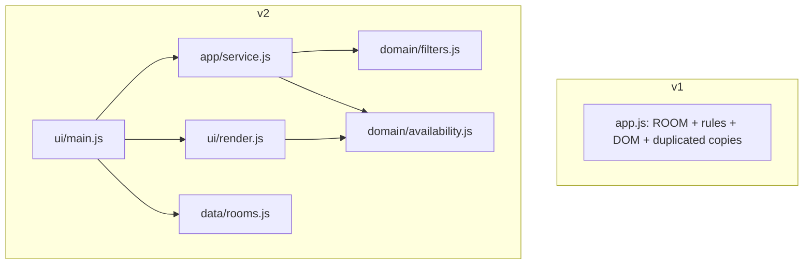

# Assignment #04 - Analysis and Refactoring Report
Smart Campus Room Availability Checker. Student: Bagdauletkyzy Akbota. AI assistant: Claude (Anthropic). All figures below come from files in `evidence/` and were produced by commands listed there.

> **Transparency note.** No earlier prototype (Assignment #03 / Practice #06) was available, so `v1_initial` is a **reconstructed baseline** written to satisfy AC1-AC6 as a typical quick monolith (it contains deliberate, realistic duplication). Features and refactoring in v2 were delivered together in one commit rather than as separate steps; see section 8.

## 1. Task #01 - Codebase analysis (v1)

**Repository map (v1_initial)**
- `app.js` (121 lines): constants `NOW`, `MAX_MINUTES`, global `ROOM`; `toStamp()`; `checkAvailability(date,start,end,now,room)` (all AC1-AC5 rules); UI functions `renderBookings()`, `liveValidate()`, `onCheck()`.
- `index.html`, `style.css`; `tests/baseline.test.js` (9 tests).
- Data flow: inputs -> `onCheck()` -> `checkAvailability()` -> text message -> `#result`.

**Maintainability risks (file/function evidence)**
1. **Duplicated rules can drift.** start>=end exists in `checkAvailability` (app.js:32) and `liveValidate` (:81); the 120-minute rule in `checkAvailability` (:38, uses `MAX_MINUTES`) and `liveValidate` (:84, hard-coded `120`). Changing the limit in one place silently desyncs the UI hint.
2. **Overlap formula duplicated** in `checkAvailability` (:48) and `renderBookings` (:67); AC4 (touching allowed) would have to be fixed twice.
3. **Hidden global room.** `checkAvailability` falls back to the global `ROOM` (:26) and `renderBookings` reads `ROOM.bookings` (:61) directly, so it cannot serve several rooms and a wrong-room check is easy.
4. **Business logic and DOM in one file**; the result is a message string and tests must match its prefix (`/^Available/`) instead of a stable code. Timestamp parsing is copy-pasted 9 times (`Date.parse(... 'T' ... ':00Z')`).

**Prioritised plan (small steps, not a rewrite)**
1. Keep AC tests as the safety net (done: 9/9 on v1). 2. Introduce catalog data module (low risk). 3. Move rules into pure `domain/availability.js` with one `toTimestamp`, one `overlaps`, one `validateRequest`; take the room as a parameter and return codes. 4. Add `domain/filters.js` (F1, F2). 5. Add `app/service.js` for state (F4, F5, per-room data). 6. UI reduced to render + events. 7. Extend tests (F1-F5, boundaries, integration, UI).

**Suggestion modified/rejected:** an early idea to add jsdom as a dev dependency for UI tests was modified: the UI was split so rendering is pure string functions testable with the built-in runner, plus a separate real-browser smoke test. A full framework rewrite was not used (not needed, higher risk).

## 2. Task #02 - Feature extension (v2)
Catalog (`v2_final/src/data/rooms.js`, fictional, deep-frozen):

| ID | Name | Capacity | Equipment | Blocked |
|---|---|---|---|---|
| R101 | Focus Pod Alpha | 4 | whiteboard | no |
| R102 | Seminar Room Beta | 20 | projector, whiteboard | no |
| R103 | Lecture Hall Gamma | 60 | projector, microphone, whiteboard, video-conferencing | no |
| R104 | Computer Lab Delta | 30 | computers, projector | **yes** |
| R105 | Workshop Studio Epsilon | 12 | whiteboard, video-conferencing | no |

Each room has its own bookings. Demonstrated in a real browser (`evidence/ui_smoke_test.txt`, screenshots in `evidence/screenshots/`):
- 5 of 5 rooms match by default; **100 attendees -> empty state** "No rooms match your requirements. Try fewer attendees or less equipment." (F4)
- 15 attendees + projector -> **3 of 5** rooms (F1+F2).
- R102 at 10:30-11:30 -> **Unavailable** (overlaps 10:00-11:30); switching to R103 clears the result (F5); R103 at 10:30-11:30 -> **Available** (touches its 09:30-10:30 booking). 360 px width: no horizontal scroll, no JS errors.

## 3. Task #03 - Refactoring

 

**Design decisions**
1. **Pure domain functions with injected `now` and the room passed in.** Testable without DOM or real clock, no hidden global (risk 3), and non-mutation (AC5) is enforceable: catalog data is deep-frozen so a stray sort/push throws.
2. **Service layer between UI and rules.** F4/F5 logic (drop a selected room that no longer matches, clear stale results) lives in `service.js` and is integration-tested without a browser.
3. **Result codes** (`OVERLAP`, `TOO_LONG`, ...) next to the message, so tests and UI do not parse text.
4. **`findConflicts` reused by the UI highlight**, so the overlap rule exists once.

## 4. Task #04 - Automated testing
Commands (from `evidence/final_test_output.txt`): `cd v2_final && npm test` -> **37 tests, 37 pass, 0 fail, exit code 0**. Baseline: `cd v1_initial && npm test` -> **9/9 pass**.
Coverage: AC1-AC5 regression (14), F1/F3/catalog (8), integration through `service.js` (9), UI render behaviour (6). Boundaries: 120 vs 121 min, touching start/end vs overlap, capacity = attendees vs attendees-1, "now" exactly. Fixed clock, fresh fixtures per test.

To check that tests can fail, 4 deliberate bugs were injected one at a time (`evidence/mutation_check.txt`): all 4 were detected, files restored, final run 37/37.

| # | Test | Ref | Result |
|---|---|---|---|
| 1 | catalog has at least 4 rooms with id, name, capacity, equipment, blocked, bookings | F1-F2 | PASS |
| 2 | F1 boundary: capacity exactly equal to attendees is included | F1 | PASS |
| 3 | F1 boundary: capacity one below attendees is excluded | F1 | PASS |
| 4 | F1 on the real catalog: 21 attendees leaves only the 30- and 60-seat rooms | F1 | PASS |
| 5 | F2 requires ALL selected equipment (AND, not OR) | F2 | PASS |
| 6 | F1+F2 combined on the real catalog | F1+F2 | PASS |
| 7 | filtering never mutates the catalog (frozen) and returns a new array | F1-F2 | PASS |
| 8 | F3 a blocked room is never reported as available | F3 | PASS |
| 9 | AC1 rejects start equal to or after end | AC1 | PASS |
| 10 | AC1 rejects a request in the past | AC1 | PASS |
| 11 | AC1 request starting exactly at "now" is not in the past | AC1 | PASS |
| 12 | AC1 rejects missing or malformed input | AC1 | PASS |
| 13 | AC2 boundary: exactly 120 minutes is accepted | AC2 | PASS |
| 14 | AC2 boundary: 121 minutes is rejected | AC2 | PASS |
| 15 | AC3 rejects a blocked room even when the time is free | AC3 | PASS |
| 16 | AC4 rejects an overlapping request (partial overlap) | AC4 | PASS |
| 17 | AC4 rejects a request fully inside / fully covering a booking | AC4 | PASS |
| 18 | AC4 boundary: touching at the end of a booking is allowed | AC4 | PASS |
| 19 | AC4 boundary: touching at the start of a booking is allowed | AC4 | PASS |
| 20 | AC4 a booking on another date does not conflict | AC4 | PASS |
| 21 | AC5 returns Available / Unavailable labels | AC5 | PASS |
| 22 | AC5 does not mutate booking data (frozen room + snapshot, unsorted input) | AC5 | PASS |
| 23 | availability uses the CHOSEN room bookings (same slot, two rooms) | extra | PASS |
| 24 | F5 switching the room clears the previous result (no stale answer) | F5 | PASS |
| 25 | F5 re-selecting the same room keeps its result | F5 | PASS |
| 26 | F4 no rooms match -> empty visible list | F4 | PASS |
| 27 | changing filters drops a selected room that no longer matches, and its result | extra | PASS |
| 28 | a room hidden by the filters cannot be selected | extra | PASS |
| 29 | checking without a selected room gives a clear message | extra | PASS |
| 30 | full flow: filter -> select -> unsuccessful -> switch -> successful | F5 | PASS |
| 31 | service never mutates the frozen catalog | F1-F2 | PASS |
| 32 | F4 UI shows a clear empty state when no rooms match | F4 | PASS |
| 33 | UI lists only matching rooms and marks blocked rooms | extra | PASS |
| 34 | F5 UI result refreshes: verdict shown, then placeholder after switching rooms | F5 | PASS |
| 35 | UI available verdict uses the success style | extra | PASS |
| 36 | UI highlights only the conflicting booking (shared overlap rule) | extra | PASS |
| 37 | UI output is HTML-escaped | extra | PASS |

## 5. Task #05 - Quality evaluation

| Measure | v1 (original) | v2 (final) | How obtained |
|---|---|---|---|
| Automated tests passed / total | 9 / 9 | 37 / 37 | `npm test` in each folder (`evidence/*_test_output.txt`). AC1-AC5 cases are mirrored in v2 (14 tests), but v1 and v2 have different APIs, so v1 tests were **not** rerun against v2 |
| Duplicated rule implementations | start>=end x2, max-duration x2, overlap x2, result-box rendering x2 sites (5 branches), date+time parsing x9 (plus 1 "now" parse) | each rule x1; date+time parsing x1 (plus 1 "now" parse) | `sh evidence/duplication_check.sh` (grep patterns, output in `evidence/duplication_check.txt`) |
| Duplicated-logic locations removed | - | **12 extra copies removed** | Per rule: (copies in v1) - (copies in v2); breakdown in the note below |
| Structure | 1 file: rules + data + DOM | 6 source modules: data (rooms), domain (availability, filters), app (service), ui (render, main) | `wc -l`: v1 app.js 121 lines; v2 src: 51+30+57+14+32+40 = 224 lines |
| Remaining limitation | - | see below | - |

Breakdown of the 12: start>=end 2->1 (1), max-duration 2->1 (1), overlap formula 2->1 (1), date+time timestamp parsing 9->1 (8), result-box rendering 2 sites->1 (1). Total 1+1+1+8+1 = **12**. Counted by rule instead of by copy: 5 duplicated rules -> 0 duplicated rules. The "now" parse (1 in v1, 1 in v2) is not a duplicate and is excluded.

**Remaining limitations**
- UI tests cover render functions and a manual Playwright smoke script, not an automated DOM test suite in `npm test`.
- Times are naive UTC-style values; no time zones, no bookings that span midnight.
- Filters run on every input event; fine for 5 rooms, no debouncing or pagination.
- Equipment names are plain strings (typos are not caught by types).

## 6. Task #06
I gave the AI assistant the assignment slides, the acceptance criteria AC1-AC6, the new requirements F1-F5 and the constraints: fictional data, a fixed clock, no login, no database. I did not have my earlier prototype from Assignment #03, so the assistant rebuilt a single-room baseline (v1). This v1 is reconstructed, not my own earlier code, and the report says so.

**What was useful.** The layered split (data, domain, filters, service, render), pure functions with an injected "now", and frozen catalog data, so any accidental mutation throws. Returning result codes instead of parsing message text also made the tests simpler.

**What was weak or wrong.** The first duplication-counting script used a wrong pattern and showed 0 for one rule in v2; the numbers looked odd, so it was fixed and rerun. A first shell command also failed to create folders. A draft report had 13 instead of 12 duplicated copies; I recomputed it per rule. The suggested jsdom for UI tests was replaced by tests of pure render functions plus a browser smoke script. The work was also done in one pass instead of one change at a time with tests after each; this is noted in the report (section 8).

**What I verified myself.** I ran `npm test` in both folders on my computer: 9/9 in v1 and 37/37 in v2 (screenshots in the report). I opened the app in my browser and checked the room list and the Blocked marker. Because all 37 tests passed on the first run, I did not treat that as proof; four deliberately injected bugs (touching counted as overlap, 120 minutes treated as too long, "some" instead of "every" for equipment, stale result after switching rooms) were each caught by the tests.

**What I learned and would do next.** Tests are only trustworthy if they can fail, and keeping each rule in one place makes both changes and tests easier. Next time I would work in smaller steps with a commit and a test run after each one. For the project, I would add automated DOM-level UI tests and support for bookings that cross midnight.

Full texts: `REFLECTION.md` and `AI_EVIDENCE.md`.

## 7. Submission checklist
- [x] Existing availability rules still work (AC1-AC5 tests; AC6 checked at 360 px and 1100 px)
- [x] 5 fictional rooms (>= 4), 1 blocked
- [x] Capacity and equipment filters work (F1, F2; tests + browser)
- [x] 37 executable tests (>= 10)
- [x] Refactoring and evaluation evidence
- [x] AI use and human review documented (student must complete the human-review parts)

## 8. Deviations (honest notes)
- v1 is reconstructed, not the student's earlier code.
- Suggested workflow says "one change at a time with tests after each". v2 was built in one pass (features + refactor), then tested; only two code commits exist.
- Time-based rules use a fixed clock; AC6 verified by one desktop and one 360 px browser run, not by a device matrix.
